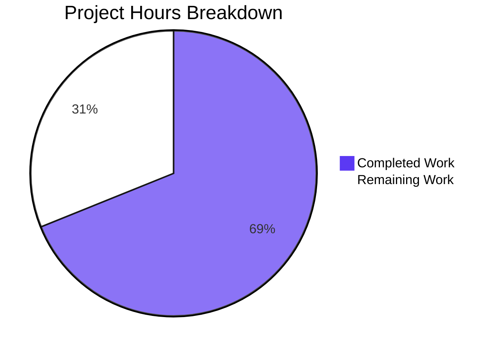

# 1. Executive Summary

`hello_world` serves two constant HTTP responses from two files at the repository root, both byte-verified.

## 1.1 Project Overview

The service answers two constant responses over HTTP. `GET /good-evening` was added alongside `/`, and express replaced Node's built-in `http` server as the HTTP layer and the project's only dependency. The service stays bound to `127.0.0.1:3000` behind the same startup line, and it now reports a failed bind instead of announcing a start that did not happen.

## 1.2 Completion Status

**69% complete** — 15.5 of the 22.5 hours scoped. Every requested deliverable is implemented and verified at run time; the remaining 7.0 hours is the path to production. Completed ÷ total = 15.5 ÷ 22.5 = **68.9%**.



| Metric | Hours |
|---|---|
| Total Hours | 22.5 |
| Completed Hours (AI + Manual) | 15.5 |
| Remaining Hours | 7.0 |

## 1.3 Key Accomplishments

- `GET /good-evening` returns 200, `text/plain; charset=utf-8`, exactly `Good evening\n` (13 bytes).
- express 5.3.0 is the only dependency and the only HTTP layer, declared once.
- `/` keeps its path, any-method acceptance, `Hello, World!\n` body and 200 status.
- One loopback listener on `127.0.0.1:3000`, from the untouched host and port constants.
- The startup line appears only when the bind succeeds; a held port exits 1 with the error.
- Unregistered paths and methods fall to express's defaults, with nothing added for them.
- 10 insertions and 8 deletions in two files; nothing created, no lockfile committed.
- Both pages render as plain text, with no scripts, subresources or JavaScript errors.

## 1.4 Critical Unresolved Issues

**0 of the 4 requested items are open.** Beyond them, 4 items stand between this revision and production: 3 path-to-production tasks (7.0 hours, Section 2.2) and 1 accepted caveat.

| Issue | Impact | Owner | ETA |
|---|---|---|---|
| Dependency provisioning is not reproducible — the committed lockfile carries no express entry, so `npm ci` fails and the `^5` range resolves afresh in every environment (1 item) | A standard or lockfile-honouring install cannot provision the service, and the installed version is not pinned | Development | 1 day |
| Deployment packaging and supervision are absent — nothing starts, supervises or restarts a service whose port is a source constant (1 item) | One instance per host or network namespace, no liveness signal captured, a second bind failing with a port error | Release engineering | 1 day |
| Target-environment acceptance has not been run — the byte-exact contract is verified only in a plain shell (1 item) | Nothing yet confirms the delivered contract holds in the environment that will run it | Release engineering | 0.5 day |
| No automated regression guard on the two response literals, the paths or the media type — accepted, because tests were excluded from this scope (1 item) | A later edit to a literal or to `res.type` can break the contract silently | Development | Not scheduled |

## 1.5 Access Issues

**No access issues identified.** No credential, remote service or repository permission is needed: the application reads no environment variable or configuration file, and its dependency resolves from the public npm registry.

## 1.6 Recommended Next Steps

1. **[High]** Pin the express version and settle a lockfile-free install path (2.0 hours).
2. **[Medium]** Package and supervise one instance per host, using the startup line as liveness (3.0 hours).
3. **[Medium]** Run acceptance in the target environment, byte-for-byte (2.0 hours).
4. **[Low]** Add a regression test for both responses and the failed-bind path if the no-tests constraint lifts.
5. **[Low]** Keep the service loopback-bound, or front it with a proxy supplying TLS and security headers.

# 2. Project Hours Breakdown

Hours are counted for the work this scope covers and for the standard steps still needed to run it in production. Completed hours (15.5) plus remaining hours (7.0) give the 22.5-hour total behind the 69% completion figure.

## 2.1 Completed Work Detail

| Component | Hours | Description |
|---|---|---|
| Express adoption and dependency declaration | 2.5 | Replaced the module's HTTP layer with express, declared it as the manifest's only dependency, and provisioned it without persisting a lockfile (`server.js:1,6,10`; `package.json:11-13`). |
| `GET /good-evening` route | 2.0 | Registered the new path with the shared single-statement responder form so it returns exactly 13 bytes of text with an explicit media type and the framework's default 200 (`server.js:8`). |
| Preserved `/` responder | 2.0 | Re-registered the existing response method-agnostically at its own path, keeping its 14-byte body, its 200 status and its acceptance of any method while emitting the shared form's header (`server.js:7`). |
| Loopback binding and startup contract | 3.0 | Carried over the host and port constants and the startup line, and made that line certify a successful bind so a failed listen fails loudly instead of reporting a false start (`server.js:3-4,10-12`). |
| Contract verification | 6.0 | Syntax check, byte-exact acceptance on both routes, method, encoding, injection, oversized-input and concurrency checks, framework-default handling, lifecycle and restart checks, and the browser-rendered check of both pages and the default 404. |
| **Total completed** | **15.5** | Matches Completed Hours in Section 1.2. |

## 2.2 Remaining Work Detail

| Category | Hours | Priority |
|---|---|---|
| Dependency provisioning and reproducibility — verify and pin the express version the `^5` range resolves to, and settle a deployment install path that works while no lockfile is committed | 2.0 | High |
| Deployment packaging and supervision — one instance per host or network namespace for the fixed `127.0.0.1:3000` binding, supervising the startup line as the liveness signal with deterministic restarts | 3.0 | Medium |
| Target-environment acceptance run — install from the settled path, boot under the supervisor, re-assert both responses byte-for-byte (`Hello, World!\n`, `Good evening\n`) and confirm the failed-bind behaviour there | 2.0 | Medium |
| **Total remaining** | **7.0** | Matches Remaining Hours in Section 1.2 and the Remaining Work slice in Section 7. |

# 3. Test Results

1,735 runtime checks were executed against this revision across the areas below, each counted once under the capability it primarily exercised. The project has no test runner, no assertion framework and no coverage tool — `npm test` is the npm-init placeholder that prints "Error: no test specified" and exits 1 — so the columns report executed checks rather than framework-reported cases, and no coverage percentage exists to state. Every check below passed in the delivered tree.

| Area / Category | Framework | Tests | Passed | Failed | Coverage | What This Proves |
|---|---|---|---|---|---|---|
| Response contract — `/` and `GET /good-evening` | None; scripted HTTP calls with byte comparison | 700 | 700 | 0 | Not measured (no coverage tool) | Both routes return exactly the specified status, media type and bytes, unchanged by query strings, bodies, headers or negotiation |
| Preserved `/` responder across methods | None; scripted method matrix | 216 | 216 | 0 | Not measured | `/` answers every method tried (GET, HEAD, POST, PUT, PATCH, DELETE, OPTIONS, TRACE, PROPFIND, LINK, SEARCH) with the same 14-byte body and 200 |
| Loopback binding and startup log | None; socket and stream inspection | 173 | 173 | 0 | Not measured | Exactly one listener on `127.0.0.1:3000`, one 41-byte startup line, empty stderr, and a failed bind exiting 1 with the port error and no success line |
| Framework-default handling of unspecified input | None; scripted path and method probes | 211 | 211 | 0 | Not measured | Unregistered paths and methods reach the framework's own 404 and `Allow: GET, HEAD`, with no added handler, middleware or hardening |
| Concurrency, lifecycle and load | None; parallel bursts, restart and signal checks | 148 | 148 | 0 | Not measured | One process serves both routes concurrently with one body digest per route, steady output, clean stop and byte-identical restart |
| Adversarial and malformed input | None; raw payload probes | 211 | 211 | 0 | Not measured | Injection, traversal, CRLF, unicode, NUL, oversized and malformed requests never alter a body, leak a path or crash the service |
| Browser-rendered pages | Headless Chrome, no test runner | 35 | 35 | 0 | Not measured | Both pages render as plain text with zero scripts, subresources and JavaScript errors, and no overflow or layout shift at 375, 768, 1280 and 1920 px |
| Deliverable integrity and gates | None; git, checksum and syntax checks | 41 | 41 | 0 | Not measured | Two files changed, nothing added or deleted, the lockfile untouched, the tree clean and `node --check server.js` silent at exit 0 |

**Not Covered** — delivered behaviour that no check exercises, and what to test before release:

- **No automated regression guard exists.** Nothing in the repository re-runs the response contract: the two literals, the two paths and the media type are protected only by the acceptance check and by review. Add a test that asserts both bodies byte-for-byte and the failed-bind exit code, or wire the acceptance check into the pipeline.
- **Boot under a supervisor, container or CI is not exercised.** No packaging exists, so nothing has started this service the way production will. The target-environment acceptance run should cover it.
- **A post-listen server error event is not exercised.** The framework's own listener handling covers an error emitted after the bind, and no check triggers one; the startup path is verified, the runtime socket-error path is not.
- **The framework's error-page rendering path is not exercised.** Nothing in the application ever passes an error to the framework, so the path that would render a stack to a client is latent and untested.
- **Failure of the dependency install is not exercised.** Provisioning is done by hand today (`npm install --no-save --package-lock=false express`); what a deployment does when the registry cannot be reached, or which version it gets, has not been tested.

# 4. Runtime Validation & UI Verification

- ✅ **Service start-up** — `node server.js` prints exactly `Server running at http://127.0.0.1:3000/` (41 bytes), writes nothing to stderr, and holds one listener on `127.0.0.1:3000`; a cold boot with an empty environment behaves identically.
- ✅ **`GET /`** — 200, `Content-Type: text/plain; charset=utf-8`, exactly 14 bytes `Hello, World!\n`, byte-identical to the response the service returned before the change.
- ✅ **`GET /good-evening`** — 200, the same media type, `Content-Length: 13`, exactly 13 bytes `Good evening\n` with its trailing line feed intact.
- ✅ **Routing and methods** — every method tried on `/` returns 200 with the constant body; unregistered methods on `/good-evening` return the framework's 404; unregistered paths return the framework's default 404 with no application code involved.
- ✅ **Failed bind** — a second instance started while the port is held exits 1, writes nothing to stdout, and prints the `EADDRINUSE` error to stderr while the first instance keeps serving both routes.
- ✅ **Load and lifecycle** — a 100-request mixed burst (50 per route, 10-way parallel) returns 200 on every request with one body digest per route; stdout stays a single line, stderr stays empty, and stopping the process by pid leaves no listener.
- ✅ **Browser rendering** — both pages display as plain text on a white page with no application markup, no script, no stylesheet, no image and no other subresource; zero JavaScript errors on either page.
- ✅ **Browser network behaviour** — statuses, media types and byte lengths seen by Chrome match the wire exactly, and repeat loads revalidate against the served ETag and return 304 with an identical cached body.
- ✅ **Framework error pages** — unmatched paths and `POST /good-evening` render the framework's own `Cannot GET …` / `Cannot POST …` page with the 404 reported by the network layer.
- ⚠ **Not exercised at runtime** — no supervisor, container or pipeline has started this service; the runtime socket-error path and the framework's error-page rendering path are never triggered; and no automated suite re-runs these checks.

# 5. Compliance & Quality Review

The matrix below records where each deliverable stands now. Divergences from the approved scope are itemised in 5.2.

## 5.1 Compliance Matrix

| # | Deliverable / Benchmark | Status | Basis |
|---|---|---|---|
| 1 | New endpoint contract — 200, `text/plain; charset=utf-8`, exactly `Good evening\n` (13 bytes) | ✅ Pass | Byte comparison on the wire and in a browser |
| 2 | express as the sole dependency, declared once | ✅ Pass | `package.json` gains one `dependencies` field; no other field changes |
| 3 | Existing `/` responder preserved — path, any method, `Hello, World!\n`, 200 | ✅ Pass | Eleven-method matrix against the live service |
| 4 | Changed-file scope — two files, nothing created, deleted or renamed | ✅ Pass | Diff against the base commit `cdeb666` |
| 5 | Minimal-diff discipline — no refactoring, reformatting or renaming | ✅ Pass | 10 insertions, 8 deletions; whitespace-insensitive diff identical |
| 6 | Lockfile left uncommitted and unmodified | ✅ Pass | `package-lock.json` checksum unchanged, absent from the diff |
| 7 | No tests, documentation, configuration or hardening added | ✅ Pass | None of these exists in the tree or the diff |
| 8 | Binding and startup contract preserved | ✅ Pass | Constants and startup line byte-identical; one loopback listener |
| 9 | Startup line certifies a successful bind | ✅ Pass | A second instance while the port is held: exit 1, empty stdout, port error on stderr |
| 10 | Framework-default handling of unspecified input | ✅ Pass | Unregistered paths and methods reach the framework's own 404 and `Allow` header |
| 11 | Input-handling and leakage posture | ✅ Pass | No request input is read; no secret, stack trace, filesystem path or live markup is reflected |
| 12 | Production provisioning and deployment readiness | ⚠ Partial | Installs are not reproducible and no packaging or supervision exists (Section 2.2) |

## 5.2 AAP & Rule Divergences and Gaps

No user-specified rule was departed from: the rule set for this work is empty, and the constraints the request states for itself are requirements, all of which are met. Eight divergences and gaps are recorded below.

| What the AAP/Rule Required | What Was Delivered Instead | Why It Diverged | Impact | Remediation |
|---|---|---|---|---|
| The listen call kept as it was, giving a 12-line `server.js` with the callback body byte-identical | A 13-line file: the callback takes the bind error and rethrows it (`server.js:10-11`) | The same scope requires the startup contract to survive the change, and the pre-change service printed its startup line only when the bind succeeded | One extra line; a failed bind now exits 1 with the error on stderr instead of reporting a false start | None — reverting it would restore the silent failure |
| A dependency addition updates the lockfile (general practice) | `package-lock.json` left byte-identical, so it carries no express entry and `npm ci` fails with `EUSAGE` | The approved scope forbids creating or committing a lockfile | Installs are not reproducible; version resolution is left to the range | Settle the provisioning path (2.0 h, Section 2.2) |
| Verify the dependency version before declaring it | `"express": "^5"` shipped as an assumed, unverified range | Dependency research and version verification were explicitly prohibited | A future 5.x release could change response framing without any code change | Verify and pin during provisioning (same row) |
| Nothing beyond the requested route and the stated response shape | express's own defaults now apply: `X-Powered-By: Express`, a weak `ETag` with 304 revalidation, and case-insensitive, trailing-slash-tolerant path matching | Suppressing them needs `app.disable(...)`/`app.set(...)` or extra middleware — the unrequested hardening the scope forbids | Informational framework fingerprint; two extra client-visible behaviours | None in scope; revisit only if the service leaves loopback |
| The existing responder's behaviour on paths it used to answer | Every path other than `/` and `/good-evening` now returns the framework's 404 instead of the old catch-all 200 | Path-based routing narrows coverage by design, and adding a handler for the old behaviour was excluded | Visible to any consumer that relied on the catch-all response; no consumer inside the repository | None in scope; note for downstream consumers |
| The pre-existing route kept unchanged | `/` now emits `text/plain; charset=utf-8` where it previously emitted bare `text/plain` | The shared responder form lets express append the charset, and that value is the specified one | Only clients that string-match the old header exactly are affected | None — it is the specified value |
| Release practice expects a regression guard plus documentation and configuration | None delivered: no test, no README change, no configuration, no build or lint gate | Tests, documentation, configuration and hardening were all excluded from this scope | The response contract is guarded by review and the acceptance check alone | Accepted; an optional focused test suite (~4 h) sits outside this scope |
| Package hygiene — a manifest whose entry point and test script work, and one obvious server | `main` still points at an absent `index.js`, `scripts.test` still exits 1, and `server - Copy.js` remains a second, divergent server in the root | This change was confined to the requested route; touching them would breach the minimal-diff contract | `npm test` always fails, and a reader can mistake the duplicate for a live entry point | Out of scope; address in a later change to the package |

**D1 — the bind guard.** The plan specified a 12-line `server.js` with the listen call's callback carried over untouched. The delivered file is 13 lines: the callback now takes the bind error and rethrows it (`server.js:10-11`), so the startup line is printed only when the listen actually succeeded. The same scope requires the binding and startup contract to survive the change, and the pre-change service printed that line if and only if the bind succeeded — a guarantee express removed by handing a bind error into the callback as its first argument. Reverting the guard to match the plan's literal snippet would restore a false success line on a held port, so it should stay. No action is required.

**D2 — the lockfile left out of sync.** Adding a dependency normally updates `package-lock.json`; here it was deliberately left byte-identical, so the file records no express entry and `npm ci` refuses to install (`npm error code EUSAGE`, "Missing: express@5.3.0 from lock file"). That is the direct consequence of the constraint forbidding a lockfile in this change, and it is why the documented install is `npm install --no-save --package-lock=false express`. The practical effect is that provisioning is manual and unversioned: the human task in Section 2.2 must decide between pinning the resolved version explicitly and allowing a committed lockfile in a later change.

**D3 — the unverified dependency range.** The manifest declares `"express": "^5"` without a registry lookup, an advisory check or a pinned version, because dependency research was prohibited for this work. express 5.3.0 is what the range resolves to in this environment, but a later install may resolve differently, and `res.send`/`res.type` framing is exactly what the byte-exact contract depends on. The acceptance check would catch a changed body, but nothing would catch it automatically. Verify and pin the version as part of the provisioning task, and keep the acceptance check in the deployment checklist.

**D4 — framework defaults now on the wire.** Beyond the requested route, express contributes its own behaviour: an `X-Powered-By: Express` header, a weak `ETag` that enables 304 revalidation, and routing that is case-insensitive and tolerant of a trailing slash, so `/GOOD-EVENING` and `/good-evening/` also return the greeting. Removing any of it requires `app.disable('x-powered-by')`, `app.set('etag', false)` or extra middleware — the unrequested hardening this scope forbids. For a loopback-bound service with two constant responses the exposure is a framework name, and 304s only make repeat loads cheaper. Revisit only if the binding leaves loopback.

**D5 — the catch-all response is gone.** The pre-change service answered every path with `Hello, World!\n` and 200. Now only `/` and `/good-evening` are registered, so `/nope`, `/index.html`, `/favicon.ico` and `//good-evening` reach express's default 404 page, which is the narrowing the approved scope records as intended and the reason no 404 handler was added. Nothing inside the repository requests those paths, and both registered routes behave as before. Any external caller that relied on the old catch-all behaviour is the only real exposure, and that fact belongs in the handover notes for whoever consumes this service.

**D6 — the charset on the preserved route.** `/` now answers `text/plain; charset=utf-8` where the previous implementation wrote bare `text/plain`. The value comes from the shared responder form both routes use, which sets the media type explicitly so express does not infer `text/html` for a string body; the approved acceptance criteria state that value for both routes. The body, the status, the path and the acceptance of every method are unchanged, so the only breakage risk is a client that compares the header value character for character. It needs no action.

**D7 — no regression guard, documentation or configuration.** Tests, documentation files, environment configuration and hardening were all excluded from this work, so the delivered repository has no test suite, no README update, no build, lint or type-check gate, and no configuration surface — `npm test` is the initial placeholder that exits 1. The consequence is that the two response literals, their paths and their media type are protected only by the acceptance check and by review; a later edit can break the contract silently. Adding a small suite is worthwhile but out of scope here, and it is not counted in the remaining hours.

**D8 — pre-existing package hazards left in place.** `"main": "index.js"` points at a file that does not exist, `scripts.test` always exits 1, and `server - Copy.js` sits in the root as a second, divergent implementation of the same service on the same port. All three predate this work and were left alone because the scope forbids unrelated changes and names the duplicate artefact explicitly. The effects are cosmetic but real: a pipeline that calls `npm test` fails by design, and a reader browsing the repository can mistake the duplicate for the live entry point. Address them in a later change to the package.

# 6. Risk Assessment

Risks are forward-looking: what could still go wrong once this revision is deployed.

| Risk | Category | Severity | Probability | Mitigation | Status |
|---|---|---|---|---|---|
| Installs are not reproducible — the committed lockfile carries no express entry, so `npm ci` fails and the `^5` range resolves afresh in every environment | Operational | High | High | Settle the provisioning path: verify and pin the resolved version, or allow a lockfile in a follow-up change (Section 2.2) | Open |
| No automated guard on the response contract — no test, lint or type-check gate exists, so a change to a literal, a path or `res.type` breaks the contract silently | Technical | Medium | Medium | Keep the byte-exact acceptance check in the deployment checklist; add a focused suite if the constraint excluding tests is lifted | Accepted (out of scope) |
| Fixed, non-overridable binding — `127.0.0.1:3000` is a source constant, so only one instance can bind per host or network namespace and a second start fails with `EADDRINUSE` | Operational | Medium | Medium | Package and supervise for one instance per host or namespace; treat the port error as a failed start (Section 2.2) | Open |
| Thin runtime signal — the only output is one line at boot, with no per-request logging, health or metrics endpoint, so a supervised restart or a traffic problem is invisible from the process itself | Operational | Medium | Medium | Use the startup line as the liveness signal in supervision and monitor from outside the application | Accepted (out of scope) |
| Unpinned dependency — a future 5.x release could change response framing without any change in this repository | Operational | Medium | Low | Verify and pin the resolved version; the acceptance check catches a changed body but only when it is run | Open |
| Framework surface exposed on the wire — `X-Powered-By: Express`, weak `ETag`/304 revalidation, and a default error page whose stack-rendering path is reachable only if application code ever passes an error (nothing does) | Security | Low | Low | Accept while the service stays loopback-bound; reassess if the binding moves | Accepted (out of scope) |
| No hardening layer and no TLS — no security headers, no rate limiting, no authentication; exposure is bounded only by the loopback binding | Security | Low | Medium | Keep the service loopback-bound behind a reverse proxy that supplies TLS and headers; treat public exposure as new scope | Accepted (out of scope) |
| Repository noise can mislead deployment tooling — a second server implementation (`server - Copy.js`) in the root, `main` pointing at an absent `index.js`, and unrelated artefacts beside the application | Integration | Low | Medium | Deploy by the explicit `node server.js` entry point and leave the pre-existing artefacts untouched | Accepted (out of scope) |

# 7. Visual Project Status

**69% complete** — 15.5 hours delivered, 7.0 hours remaining out of 22.5 total.


Remaining hours by category (detail in Section 2.2):

| Category | Hours | Priority |
|---|---|---|
| Dependency provisioning and reproducibility | 2.0 | High |
| Deployment packaging and supervision | 3.0 | Medium |
| Target-environment acceptance run | 2.0 | Medium |
| **Total remaining** | **7.0** | — |

Delivery by capability:

| Capability | State | Evidence the reader can open |
|---|---|---|
| `GET /good-evening` | Delivered and verified | `server.js:8`; byte-exact on the wire and in a browser |
| express as the HTTP layer | Delivered and verified | `server.js:1,6,10`; `package.json:11-13` |
| `/` responder preserved | Delivered and verified | `server.js:7`; eleven-method matrix |
| Loopback binding and startup log | Delivered and verified | `server.js:3-4,10-12`; one listener, one startup line |
| Failed-bind reporting | Delivered and verified | `server.js:10-11`; exit 1, empty stdout, port error on stderr |
| Production provisioning and packaging | Not started | Section 2.2 |

# 8. Summary & Recommendations

The requested change is complete and verified end to end. The service answers a second, independently addressable endpoint — `GET /good-evening` returns 200, `text/plain; charset=utf-8` and exactly 13 bytes `Good evening\n` — while the existing `/` responder keeps its path, its acceptance of any method, its `Hello, World!\n` body and its 200 status. express is now the HTTP layer and the project's only dependency, declared once in `package.json`. The change is confined to `server.js` and `package.json`: 10 insertions and 8 deletions, no file created, no lockfile committed, and no unrelated line touched. The startup line now certifies what it claims: a bind that fails exits 1 with the port error on stderr instead of announcing a start that never happened.

Verification covered more than the happy path. Both responses were compared byte for byte on the wire and in a real browser, including the trailing line feed; the method matrix, query strings, encodings, oversized and malformed requests, injection-shaped payloads, concurrency, restarts, shutdown and the failed-bind path were all exercised. 1,735 runtime checks passed against this revision, and the only console output a browser produces is its own failed probe for a favicon that the service deliberately does not serve. Against the 22.5 hours this scope covers, 15.5 hours are complete: **69% complete**, with all four requested deliverables delivered and the outstanding 7.0 hours on the path to production.

The critical path to production is short and specific. First, provisioning must become reproducible: the committed lockfile carries no express entry, so `npm ci` fails and the `^5` range resolves afresh in every environment — verify the resolved version, pin it, and settle the install path (2.0 hours). Second, the service needs packaging and supervision suited to a fixed `127.0.0.1:3000` binding, one instance per host or network namespace, with the 41-byte startup line as the liveness signal and deterministic restarts (3.0 hours). Third, one acceptance run in the target environment must re-assert both responses byte-for-byte and confirm the failed-bind behaviour there (2.0 hours). Success looks like a supervised start whose log contains the exact startup line, both responses matching their expected bytes in the deployed environment, and a held port producing an exit code and an error rather than a false success.

Production readiness is therefore conditional, not blocked. Functionally the revision is ready: it parses cleanly, carries no placeholder, stub or TODO anywhere, holds one loopback listener, leaks nothing, and its behaviour is verified outside any test framework's forgiveness. What is missing is operational scaffolding the request deliberately excluded — no lockfile, no test suite, no packaging, no health or metrics surface — so the deployment must supply supervision and monitoring, and whoever operates it should know that `npm ci`, `npm test` and any expectation of security headers will fail as shipped. Two cautions belong in the handover: keep the bind guard in `server.js:10-11` when the file is next tidied, because removing it restores a silent false start, and keep the byte-exact acceptance check in the release checklist, because nothing else guards the two response literals.

Recommended order of work: settle provisioning, then packaging and supervision, then the target-environment acceptance run — 7.0 hours in total, after which the delivered capability can be operated rather than merely demonstrated. Everything beyond that (a regression suite, hardening headers, a lockfile in a future change, cleaning up the duplicate `server - Copy.js`) is optional scope that this revision consciously leaves to a later decision.

# 9. Development Guide

### System Prerequisites

- **Node.js 22.23.4** (any 20.x ≥ 20.20.2 or 22.x ≥ 22.12.0 works) with CommonJS support, and **npm 11.21.0**. Nothing else is required: no database, message broker, cache, service, VPN, migration, seed data, licence, environment variable or secret. The application reads no `process.env` and no configuration file.
- **No virtual environment and no isolation tooling** are needed. Isolation is the per-checkout `node_modules/` directory plus the shared npm cache.
- **No build step exists** — no bundler, transpiler, linter or type checker. The compile gate is a syntax check.
- The service binds `127.0.0.1:3000`, and both values are source constants in `server.js:3-4`; do not parameterise them.

### Environment Setup

```bash
# from a clone of this repository (the repository root is the application root)
node --version        # expect v22.x
npm --version         # expect 11.x
```

### Dependency Installation

`node_modules/` never travels through git, so every checkout installs for itself. express is the only dependency:

```bash
CI=true npm install --no-save --package-lock=false --no-audit --no-fund express
# expected: "added 65 packages" (or "changed 65 packages"), exit 0
```

- `--no-save --package-lock=false` is required: `package-lock.json` must stay byte-identical, because this project commits no lockfile change.
- Never commit `node_modules/` or a lockfile change. If the manifest already declares express, a plain `npm install` also works — still do not commit a lockfile change.
- `npm ci` will **not** work: the committed lockfile carries no express entry, so it fails with `npm error code EUSAGE` and `Missing: express@5.3.0 from lock file`. Use the command above instead.

### Application Startup

```bash
# run in the foreground from the repository root
node server.js
# expected, one line, then the process stays in the foreground:
# Server running at http://127.0.0.1:3000/

# or start it detached and keep the pid for a later stop
nohup node server.js > server.out 2> server.err &
echo $!
```

Because port 3000 is a source constant, only one instance can hold it per host or network namespace. To run this service where something else already owns the port, give it its own network namespace:

```bash
unshare -rn sh -c 'ip link set lo up; node server.js >/dev/null 2>&1 & P=$!; sleep 1; curl -si http://127.0.0.1:3000/ | head -3; kill $P'
# `ip link set lo up` is mandatory: a fresh namespace starts with loopback down
```

To stop a detached instance, use the pid the start printed (`kill <pid>`), or the owner of the port (`kill "$(lsof -ti :3000)"`).

### Verification Steps

```bash
# 1. compile gate — silent, exit 0
node --check server.js

# 2. the listener is loopback-only and owned by the process you started
ss -ltnp | grep ':3000'
# expect: LISTEN ... 127.0.0.1:3000 ... users:(("node",pid=<pid>,...))

# 3. both responses, byte for byte (13 and 14 bytes, each ending in a line feed)
curl -si http://127.0.0.1:3000/good-evening
curl -s  http://127.0.0.1:3000/good-evening | od -An -tx1 | tr -d ' \n'; echo
# expect: 476f6f64206576656e696e670a
curl -s  http://127.0.0.1:3000/ | od -An -tx1 | tr -d ' \n'; echo
# expect: 48656c6c6f2c20576f726c64210a

# 4. whole-package acceptance gate — expect both legs to PASS
unshare -rn sh -c 'ip link set lo up; node server.js >/dev/null 2>&1 & P=$!; sleep 1; \
  body=$(curl -s http://127.0.0.1:3000/good-evening | od -An -tx1 | tr -d " \n"); \
  root=$(curl -s http://127.0.0.1:3000/ | od -An -tx1 | tr -d " \n"); kill $P; \
  echo "root_hex=$root"; echo "good-evening_hex=$body"; \
  [ "$body" = "476f6f64206576656e696e670a" ] && echo "good-evening PASS" || echo "good-evening FAIL"; \
  [ "$root" = "48656c6c6f2c20576f726c64210a" ] && echo "root PASS" || echo "root FAIL"'

# 5. any method on / returns the same body and status
for m in GET POST PUT DELETE PATCH OPTIONS TRACE HEAD; do \
  printf '%s=%s ' "$m" "$(curl -s -o /dev/null -w '%{http_code}' -X $m http://127.0.0.1:3000/)"; done; echo
# expect: GET=200 POST=200 PUT=200 DELETE=200 PATCH=200 OPTIONS=200 TRACE=200 HEAD=200

# 6. the startup line certifies a real bind — a second instance must fail loudly
node server.js; echo "exit=$?"
# expect: exit=1, nothing on stdout, "Error: listen EADDRINUSE: address already in use 127.0.0.1:3000" on stderr
```

### Example Usage

```bash
# the new endpoint
curl -i http://127.0.0.1:3000/good-evening
# HTTP/1.1 200 OK
# X-Powered-By: Express
# Content-Type: text/plain; charset=utf-8
# Content-Length: 13
# ETag: W/"d-7fFyiNLFhmJrNT+BforqesSHNow"
# ...
# Good evening

# the existing endpoint, any method
curl -i -X POST http://127.0.0.1:3000/
# HTTP/1.1 200 OK ... Content-Length: 14 ... Hello, World!

# an unregistered path or method is answered by the framework's own 404
curl -i http://127.0.0.1:3000/nope            # 404, Cannot GET /nope
curl -i -X POST http://127.0.0.1:3000/good-evening   # 404, Cannot POST /good-evening
```

### Troubleshooting

| Symptom | Cause | Resolution |
|---|---|---|
| `Error: listen EADDRINUSE: address already in use 127.0.0.1:3000` and exit 1 | Port 3000 is already held — by an earlier instance of this server or another process | Stop the holder (`kill "$(lsof -ti :3000)"`) or run in a private network namespace as shown above. The port cannot be changed; it is a source constant. |
| `Error: Cannot find module 'express'` | The dependency was never installed in this checkout | Run the install command above. |
| `npm error code EUSAGE … Missing: express@5.3.0 from lock file` | `npm ci` was used; the committed lockfile deliberately carries no express entry | Use `CI=true npm install --no-save --package-lock=false --no-audit --no-fund express`. |
| `npm test` exits 1 with "Error: no test specified" | `scripts.test` is the npm-init placeholder; there is no test suite | Expected. Do not treat it as a failing build; use the acceptance gate in step 4 instead. |
| `xxd: command not found` | `xxd` is not installed on every host | Use `od -An -tx1` or `od -c` for byte inspection. |
| Startup line appears but nothing answers on the port | The line is now printed only after a successful listen, so this indicates the process was killed or the namespace differs | Check the listener with `ss -ltnp \| grep :3000` inside the same namespace as the curl. |
| A `304 Not Modified` instead of the body | The client sent `If-None-Match` with the served `ETag` | Expected cache revalidation; use `curl -H 'Cache-Control: no-cache'` or inspect the cached body. |

# 10. Appendices

Reference material for building, running and operating this revision. Paths are relative to the repository root.

## A. Command Reference

| Purpose | Command |
|---|---|
| Install the dependency (once per checkout) | `CI=true npm install --no-save --package-lock=false --no-audit --no-fund express` |
| Compile/syntax gate | `node --check server.js` |
| Start the service | `node server.js` |
| Start detached and keep the pid | `nohup node server.js > server.out 2> server.err & echo $!` |
| Run isolated when port 3000 is taken | `unshare -rn sh -c 'ip link set lo up; node server.js & P=$!; sleep 1; curl -si http://127.0.0.1:3000/ \| head -3; kill $P'` |
| Show the listener | `ss -ltnp \| grep ':3000'` |
| Stop by port owner | `kill "$(lsof -ti :3000)"` |
| Inspect bytes | `curl -s http://127.0.0.1:3000/good-evening \| od -An -tx1` |
| Whole-package acceptance gate | the `unshare -rn …` block in Section 9, step 4 |
| List changes against the base | `git diff --name-status cdeb6660855e25a71579d4b178b40fbae4d8df68...HEAD` |

## B. Port Reference

| Port | Binding | Notes |
|---|---|---|
| 3000 | `127.0.0.1` only | Fixed in source (`server.js:4`). Loopback-only, so it is unreachable from other hosts; exactly one instance can hold it per host or network namespace, and a second start exits 1 with `EADDRINUSE`. No other port is opened, and the process makes no outbound connections. |

## C. Key File Locations

| Path | Role |
|---|---|
| `server.js` | The entire application: the express app, both route registrations, the host/port constants and the listen call with its startup line. |
| `package.json` | The manifest: identity fields plus the single `dependencies` entry (`express`, `^5`). |
| `package-lock.json` | Committed but deliberately unmodified: it carries no express entry, which is why `npm ci` fails. |
| `README.md` | Pre-existing project note, unchanged by this work. |
| `server - Copy.js` | Pre-existing duplicate of the old `http`-based server, kept in the root and not part of the running service. |
| Repository root | 18 tracked files in total, including unrelated pre-existing artefacts (PDF, DOC, JPG, CSV, Java and empty `.txt` files) and their `- Copy` duplicates. |

## D. Technology Versions

| Component | Version | Notes |
|---|---|---|
| Node.js | 22.23.4 | CommonJS; any 20.x ≥ 20.20.2 or 22.x ≥ 22.12.0 is supported. |
| npm | 11.21.0 | Registry `https://registry.npmjs.org`. |
| express | 5.3.0 | Resolved from the manifest range `^5`; the version is not pinned and the lockfile records no entry. |
| Built-in `http` module | Node 22.23.4 | No longer required by the application; express supplies the HTTP layer. |
| Other dependencies | none | express is the only declared dependency; its own transitive packages come with it. |

## E. Environment Variable Reference

| Variable | Required | Purpose |
|---|---|---|
| none | — | The application reads no environment variable and no configuration file; both route responses and the binding are compile-time constants. Cold-booting with an empty environment produces identical behaviour. |

## F. Developer Tools Guide

| Tool | Use here |
|---|---|
| `node --check` | The compile gate for `server.js`; silent at exit 0. |
| `curl` | Drive both routes, inspect headers (`-si`), read `EADDRINUSE` behaviour and status codes (`-o /dev/null -w '%{http_code}'`). |
| `od -An -tx1` / `od -c` | Byte-level inspection of response bodies. `xxd` is **not** installed on every host, so prefer `od`. |
| `ss -ltnp` | Confirm the single loopback listener and the owning pid. |
| `unshare -rn` and `ip` | Give the service a private network namespace when port 3000 is already held; `ip link set lo up` is required inside a fresh namespace. |
| `git` | Compare against the base commit `cdeb6660855e25a71579d4b178b40fbae4d8df68`; the delivered work is commits `342cd53` and `7cf6c29`, plus `b496893`, which makes the startup line certify a successful bind. |
| Absent by design | No test runner, linter, type checker, coverage tool or security scanner exists in this project, and none was added. |

## G. Glossary

| Term | Meaning here |
|---|---|
| AAP | The approved plan that scoped this work: the two changed files, the two routes, the dependency, and the explicit exclusions. |
| Byte-exact | The response body is compared as bytes, including its trailing line feed, rather than as text. |
| Startup line | The single line `Server running at http://127.0.0.1:3000/` printed on stdout after a successful bind — the service's only runtime signal. |
| Loopback-only | Bound to `127.0.0.1`, so the service accepts connections only from the local machine. |
| Lockfile | `package-lock.json`, which pins the exact dependency tree; this revision commits no change to it. |
| Media type | The `Content-Type` value both routes emit: `text/plain; charset=utf-8`. |
| Framework default | Behaviour supplied by express for input the request does not specify — the 404 page, `Allow: GET, HEAD` on `OPTIONS`, `ETag` revalidation, and the default response headers. |
| Path-to-production | The 7.0 hours of work behind the 69% figure: provisioning, packaging and supervision, and acceptance in the target environment. |
