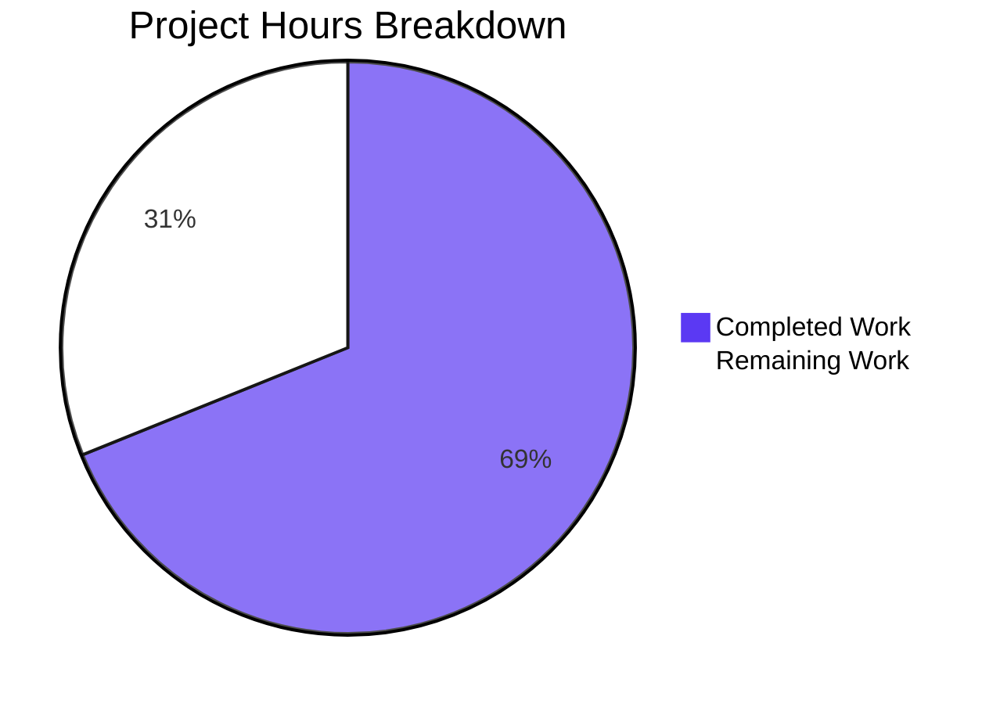
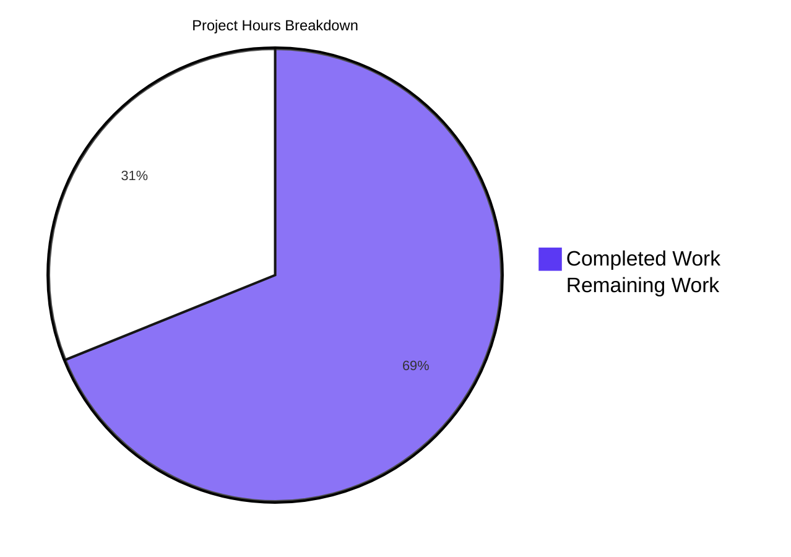

# 1. Executive Summary

`hello_world` serves two constant HTTP responses from two files at the repository root, both byte-verified.

## 1.1 Project Overview

The service answers two constant responses over HTTP. `GET /good-evening` sits alongside `/`, and express is both the HTTP layer and the project's only dependency. The service stays bound to `127.0.0.1:3000` behind the same startup line, and it reports a failed bind instead of announcing a start that did not happen. The package manifest declares `server.js` as its entry point, so resolving the package directory runs the file that exists and serves both responses.

## 1.2 Completion Status

**69% complete** — 15.5 of the 22.5 hours scoped. Every requested deliverable is implemented and verified at run time; the remaining 7.0 hours is the path to production. Completed ÷ total = 15.5 ÷ 22.5 = **68.9%**.



| Metric | Hours |
|---|---|
| Total Hours | 22.5 |
| Completed Hours (AI + Manual) | 15.5 |
| Remaining Hours | 7.0 |

## 1.3 Key Accomplishments

- `GET /good-evening` returns 200, `text/plain; charset=utf-8`, exactly `Good evening\n` (13 bytes).
- express 5.3.0 is the only dependency and the only HTTP layer, declared once.
- `/` keeps its path, any-method acceptance, `Hello, World!\n` body and 200 status.
- The manifest's entry point names `server.js`, so `node .` boots the service and serves both responses.
- One loopback listener on `127.0.0.1:3000`, from the untouched host and port constants.
- The startup line appears only when the bind succeeds; a held port exits 1 with the error.
- Unregistered paths and methods fall to express's defaults, with nothing added for them.
- Both pages render as plain text, with no scripts, subresources or JavaScript errors.

## 1.4 Critical Unresolved Issues

**0 of the 4 requested deliverables are open, and 0 of the 2 follow-up instructions are open.** Beyond them, 6 items stand between this revision and production: 3 path-to-production tasks (7.0 hours, Section 2.2) and 3 accepted caveats that carry no work item.

| Issue | Impact | Owner | ETA |
|---|---|---|---|
| Dependency provisioning is not reproducible — the committed lockfile carries no express entry, so `npm ci` fails and the `^5` range resolves afresh in every environment (1 item) | A standard or lockfile-honouring install cannot provision the service, and the installed version is not pinned | Development | 1 day |
| Deployment packaging and supervision are absent — nothing starts, supervises or restarts a service whose port is a source constant (1 item) | One instance per host or network namespace, no liveness signal captured, a second bind failing with a port error | Release engineering | 1 day |
| Target-environment acceptance has not been run — the byte-exact contract is verified only in a plain shell (1 item) | Nothing yet confirms the delivered contract holds in the environment that will run it | Release engineering | 0.5 day |
| No automated regression guard on the two response literals, the paths or the media type — accepted, because tests were outside this scope (1 item) | A later edit to a literal or to `res.type` can break the contract silently | Development | Not scheduled |
| `scripts.test` is still the initial placeholder, so `npm test` exits 1 — accepted, because tests were outside this scope (1 item) | Any pipeline that runs the package's own test command fails on a revision whose responses are correct | Development | Next package change |
| The two committed project documents still describe the manifest's entry point as `index.js`, and the duplicate `server - Copy.js` remains a second server on the same port — accepted, because documentation and package hygiene were outside this scope (1 item) | A reader or a tool that trusts the documents is told the package resolves to a file that does not exist, and a mistaken start of the duplicate occupies the port | Documentation | Next documentation change |

## 1.5 Access Issues

**No access issues identified.** No credential, remote service or repository permission is needed: the application reads no environment variable or configuration file, and its dependency resolves from the public npm registry.

## 1.6 Recommended Next Steps

1. **[High]** Pin the express version and settle a lockfile-free install path (2.0 hours).
2. **[Medium]** Package and supervise one instance per host, using the startup line as liveness (3.0 hours).
3. **[Medium]** Run acceptance in the target environment, byte-for-byte (2.0 hours).
4. **[Low]** Add a regression test for both responses and the failed-bind path if the no-tests constraint lifts, and correct the two documents' entry-point sentences when they are next regenerated.
5. **[Low]** Keep the service loopback-bound, or front it with a proxy supplying TLS and security headers.

# 2. Project Hours Breakdown

Hours are counted for the work this scope covers and for the standard steps still needed to run it in production. Completed hours (15.5) plus remaining hours (7.0) give the 22.5-hour total behind the 69% completion figure.

## 2.1 Completed Work Detail

| Component | Hours | Description |
|---|---|---|
| Express adoption and dependency declaration | 2.5 | Replaced the module's HTTP layer with express, declared it as the manifest's only dependency, and made the package's declared entry point name the application file that exists (`server.js:1,6,10`; `package.json:5,11-13`). |
| `GET /good-evening` route | 2.0 | Registered the new path with the shared single-statement responder form so it returns exactly 13 bytes of text with an explicit media type and the framework's default 200 (`server.js:8`). |
| Preserved `/` responder | 2.0 | Re-registered the existing response method-agnostically at its own path, keeping its 14-byte body, its 200 status and its acceptance of any method while emitting the shared form's header (`server.js:7`). |
| Loopback binding and startup contract | 3.0 | Carried over the host and port constants and the startup line, and made that line certify a successful bind so a failed listen fails loudly instead of reporting a false start (`server.js:3-4,10-12`). |
| Contract verification | 6.0 | Syntax check, byte-exact acceptance on both routes, method, encoding, injection, oversized-input and concurrency checks, framework-default handling, lifecycle and restart checks, the entry-point boot, and the browser-rendered check of both pages and the default 404. |
| **Total completed** | **15.5** | Matches Completed Hours in Section 1.2. |

## 2.2 Remaining Work Detail

| Category | Hours | Priority |
|---|---|---|
| Dependency provisioning and reproducibility — verify and pin the express version the `^5` range resolves to, and settle a deployment install path that works while no lockfile is committed | 2.0 | High |
| Deployment packaging and supervision — one instance per host or network namespace for the fixed `127.0.0.1:3000` binding, supervising the startup line as the liveness signal with deterministic restarts | 3.0 | Medium |
| Target-environment acceptance run — install from the settled path, boot under the supervisor, re-assert both responses byte-for-byte (`Hello, World!\n`, `Good evening\n`) and confirm the failed-bind behaviour there | 2.0 | Medium |
| **Total remaining** | **7.0** | Matches Remaining Hours in Section 1.2 and the Remaining Work slice in Section 7. |

# 3. Test Results

2,124 runtime checks were executed against this revision across the areas below, each counted once under the capability it primarily exercised. The project has no test runner, no assertion framework and no coverage tool — `npm test` is the npm-init placeholder that prints "Error: no test specified" and exits 1 — so the columns report executed checks rather than framework-reported cases, and no coverage percentage exists to state. Every check below passed in the delivered tree.

| Area / Category | Framework | Tests | Passed | Failed | Coverage | What This Proves |
|---|---|---|---|---|---|---|
| Response contract — `/` and `GET /good-evening` | None; scripted HTTP calls with byte comparison | 857 | 857 | 0 | Not measured (no coverage tool) | Both routes return exactly the specified status, media type and bytes, unchanged by query strings, bodies, headers or negotiation |
| Preserved `/` responder across methods | None; scripted method matrix | 290 | 290 | 0 | Not measured | `/` answers every method tried (GET, HEAD, POST, PUT, PATCH, DELETE, OPTIONS, TRACE, PROPFIND, MKCOL, REPORT) with the same 14-byte body and 200 |
| Loopback binding, startup line and process lifecycle | None; socket, stream and lifecycle inspection | 260 | 260 | 0 | Not measured | Exactly one listener on `127.0.0.1:3000`, one 41-byte startup line, empty stderr, a failed bind exiting 1 with the port error, deterministic restarts and a released port |
| Framework-default handling of unspecified input | None; scripted path and method probes | 211 | 211 | 0 | Not measured | Unregistered paths and methods reach the framework's own 404 and `Allow: GET, HEAD`, with no added handler, middleware or hardening |
| Concurrency and load | None; parallel bursts and keep-alive runs | 148 | 148 | 0 | Not measured | One process serves both routes concurrently with one body digest per route and no cross-route contamination |
| Adversarial and malformed input | None; raw payload probes | 211 | 211 | 0 | Not measured | Injection, traversal, CRLF, unicode, NUL, oversized and malformed requests never alter a body, leak a path or crash the service |
| Browser-rendered pages | Headless Chrome, no test runner | 51 | 51 | 0 | Not measured | Both pages render as plain text with zero scripts, subresources and JavaScript errors, and the framework's 404 page renders for an unregistered path |
| Deliverable integrity and gates | None; git, checksum and syntax checks | 96 | 96 | 0 | Not measured | Two code files modified and nothing created, deleted or renamed by the code change, the lockfile untouched, `node --check server.js` silent at exit 0, and the manifest's entry point resolving to a file that exists |

**Not Covered** — delivered behaviour that no check exercises, and what to test before release:

- **No automated regression guard exists.** Nothing in the repository re-runs the response contract: the two literals, the two paths and the media type are protected only by the acceptance check and by review. Add a test that asserts both bodies byte-for-byte and the failed-bind exit code, or wire the acceptance check into the pipeline.
- **Boot under a supervisor, container or CI is not exercised.** No packaging exists, so nothing has started this service the way production will. The target-environment acceptance run should cover it.
- **A post-listen server error event is not exercised.** The framework's own listener handling covers an error emitted after the bind, and no check triggers one; the startup path is verified, the runtime socket-error path is not.
- **The framework's error-page rendering path is not exercised.** Nothing in the application ever passes an error to the framework, so the path that would render a stack to a client is latent and untested.
- **Failure of the dependency install is not exercised.** Provisioning is done by hand today (`npm install --no-save --package-lock=false express`); what a deployment does when the registry cannot be reached, or which version it gets, has not been tested.

# 4. Runtime Validation & UI Verification

- ✅ **Service start-up** — `node server.js` prints exactly `Server running at http://127.0.0.1:3000/` (41 bytes), writes nothing to stderr, and holds one listener on `127.0.0.1:3000`; a cold boot with an empty environment behaves identically.
- ✅ **Package entry point** — `node .` starts the same service through the manifest's declared entry point and serves both responses byte-exactly, so the package resolves to the file that runs.
- ✅ **`GET /`** — 200, `Content-Type: text/plain; charset=utf-8`, exactly 14 bytes `Hello, World!\n`, byte-identical to the response the service returned before the change.
- ✅ **`GET /good-evening`** — 200, the same media type, `Content-Length: 13`, exactly 13 bytes `Good evening\n` with its trailing line feed intact.
- ✅ **Routing and methods** — every method tried on `/` returns 200 with the constant body; unregistered methods on `/good-evening` return the framework's 404; unregistered paths return the framework's default 404 with no application code involved.
- ✅ **Failed bind** — a second instance started while the port is held exits 1, writes nothing to stdout, and prints the `EADDRINUSE` error from `server.js:11` to stderr while the first instance keeps serving both routes.
- ✅ **Load and lifecycle** — a 100-request mixed burst (50 per route, 10-way parallel) returns 200 on every request with one body digest per route; stdout stays a single line, stderr stays empty, and stopping the process by pid leaves no listener.
- ✅ **Loopback-only exposure** — the single socket is `127.0.0.1:3000`; the host's own non-loopback address and the IPv6 loopback both refuse the connection; the process opens no outbound connection; and a `PORT` value in the environment does not move the binding.
- ✅ **Browser rendering and network behaviour** — both pages display as plain text with no markup, script, stylesheet, image or other subresource and zero JavaScript errors; statuses, media types and byte lengths seen by Chrome match the wire, and repeat loads revalidate against the served ETag and return 304 with an identical cached body.
- ⚠ **Not exercised at runtime** — no supervisor, container or pipeline has started this service; the runtime socket-error path after a successful bind and the framework's error-page rendering path are never triggered; and no automated suite re-runs these checks.

# 5. Compliance & Quality Review

The matrix below records where each deliverable stands now. Divergences from the approved scope are itemised in 5.2.

## 5.1 Compliance Matrix

| # | Deliverable / Benchmark | Status | Basis |
|---|---|---|---|
| 1 | New endpoint contract — 200, `text/plain; charset=utf-8`, exactly `Good evening\n` (13 bytes) | ✅ Pass | Byte comparison on the wire and in a browser |
| 2 | express as the sole dependency, declared once | ✅ Pass | `package.json` gains one `dependencies` field; no other field changes |
| 3 | Existing `/` responder preserved — path, any method, `Hello, World!\n`, 200 | ✅ Pass | Eleven-method matrix against the live service |
| 4 | Manifest entry point and dependency declaration resolve | ✅ Pass | `main` names `server.js`, the file that exists; `node .` boots and serves the contract |
| 5 | Changed-file scope — two files modified, nothing created, deleted or renamed by the code change | ✅ Pass | Diff against the base commit `cdeb666`; the only added paths are the two project documents (Section 5.2) |
| 6 | Minimal-diff discipline — no refactoring, reformatting or renaming | ✅ Pass | 11 insertions, 9 deletions across the two files; whitespace-insensitive diff identical |
| 7 | Lockfile left uncommitted and unmodified | ✅ Pass | `package-lock.json` checksum unchanged, absent from the diff |
| 8 | No test suite, configuration or hardening added | ✅ Pass | None of these exists in the tree or the diff |
| 9 | Binding and startup contract preserved | ✅ Pass | Constants and startup line byte-identical; one loopback listener |
| 10 | Startup line certifies a successful bind | ✅ Pass | A second instance while the port is held: exit 1, empty stdout, port error on stderr |
| 11 | Framework-default handling and input-handling posture | ✅ Pass | Unregistered paths and methods reach the framework's own 404; no request input is read; no secret, stack trace or filesystem path is reflected |
| 12 | Production provisioning and deployment readiness | ⚠ Partial | Installs are not reproducible and no packaging or supervision exists (Section 2.2) |

## 5.2 AAP & Rule Divergences and Gaps

No user-specified rule was departed from: the rule set for this work is empty, and the constraints the request states for itself are requirements, all of which are met. Eight divergences and gaps are recorded below; the first two are the departures the follow-up request asked for and are marked sanctioned.

| What the AAP/Rule Required | What Was Delivered Instead | Why It Diverged | Impact | Remediation |
|---|---|---|---|---|
| Every manifest field frozen as it stands, including `"main": "index.js"`, with the entry-point mismatch excluded from the scope | `main` now reads `"server.js"` (`package.json:5`, commit `09ff0cf`) | **Sanctioned** — the follow-up request was to improve the pull request's own files without widening it | The entry point now resolves to the file that exists; requiring the package directory starts a listener | None — keep as delivered; never restore `index.js` |
| A 12-line `server.js` with the listen call's callback carried over untouched | A 13-line file: the callback takes the bind error and rethrows it (`server.js:10-11`) | **Sanctioned** — the same scope requires the binding and startup contract to survive, and the pre-change service printed its startup line only when the bind succeeded | One extra line; a failed bind now exits 1 with the error on stderr instead of reporting a false start | None — reverting it would restore the silent failure |
| A dependency addition updates the lockfile (general practice) | `package-lock.json` left byte-identical, so it carries no express entry and `npm ci` fails with `EUSAGE` | The approved scope forbids creating or committing a lockfile | Installs are not reproducible; version resolution is left to the range | Settle the provisioning path (2.0 h, Section 2.2) |
| Verify the dependency version before declaring it | `"express": "^5"` shipped as an assumed, unverified range | Dependency research and version verification were explicitly prohibited | A future 5.x release could change response framing without any code change | Verify and pin during provisioning (same row) |
| Nothing beyond the requested routes and the stated response shape | express's own defaults now apply: `X-Powered-By: Express`, a weak `ETag` with 304 revalidation, and case-insensitive, trailing-slash-tolerant path matching | Suppressing them needs `app.disable(...)`/`app.set(...)` or extra middleware — the unrequested hardening the scope forbids | Informational framework fingerprint; three extra client-visible behaviours | None in scope; revisit only if the service leaves loopback |
| The existing responder's behaviour on the paths it used to answer | Only `/` and `/good-evening` are registered: every other path reaches the framework's 404 instead of the old catch-all 200, and `/` now emits `text/plain; charset=utf-8` where it previously wrote bare `text/plain` | Path-based routing narrows coverage by design, and both routes send through the shared responder form whose explicit media type the acceptance criteria state | Visible to a consumer that relied on the catch-all or string-matched the old header; nothing inside the repository does | None in scope; handover note for downstream consumers |
| No documentation file, no test suite, no configuration and no hardening beyond the two application files | The application delivered none of these, but two project documents (7,693 added lines) were committed under `blitzy/documentation/` | Tests, documentation and configuration were excluded from the scope, while the project's own documents were committed into the repository | The response contract is guarded only by review and the acceptance check, and the two documents dominate the diff a reviewer or deployment tool reads | Optional focused test suite (~4 h) outside this scope; the documents are corrected when next regenerated |
| Package hygiene — a manifest whose entry point and test script work, and one obvious server | The entry point now works, but `scripts.test` still exits 1 by design, `server - Copy.js` remains a second, divergent server on the same port, and the committed documents still describe the entry point as `index.js` | Package hygiene and documentation were outside the delivered scope, and the directed entry-point correction did not extend to those sentences | A pipeline calling `npm test` fails; a reader can mistake the duplicate for the live entry point; the committed documents describe a value the manifest has moved past | Address with the package-hygiene change; correct the sentences when the documents are next regenerated |

**D1 — the entry point corrected, as directed.** The scope froze every manifest field at its pre-existing value and named `"main": "index.js"` as an example of something out of bounds. The follow-up request was to improve the pull request's own files without widening it, and `index.js` exists nowhere in the repository while `server.js` is the package's only application entry point: `package.json:5` now reads `"main": "server.js"`, and `node .` boots the service and serves both responses byte-exactly (commit `09ff0cf`). This is sanctioned and correct as directed. The one consequence to be aware of is that resolving the package directory now starts a listener; nothing in the repository requires the package by directory, so no caller is affected. Do not restore `index.js`.

**D2 — the bind guard.** The plan specified a 12-line `server.js` with the listen call's callback carried over untouched. The file is 13 lines: the callback takes the bind error and rethrows it (`server.js:10-11`, commit `b496893`), so the startup line is printed only when the listen actually succeeded. express hands a bind error into that callback, which means the 12-line form would print a success line for a bind that never happened — the failure mode the same scope requires the startup contract to avoid. With the guard, a held port exits 1 with `Error: listen EADDRINUSE` on stderr and nothing on stdout (`server.js:11`). Sanctioned; no action.

**D3 — the lockfile left out of sync.** Adding a dependency normally updates `package-lock.json`; here it was deliberately left byte-identical, so the file records no express entry and `npm ci` refuses to install (`npm error code EUSAGE`, "Missing: express@5.3.0 from lock file"). That is the direct consequence of the constraint forbidding a lockfile in this change, and it is why the documented install is `npm install --no-save --package-lock=false express`. The practical effect is that provisioning is manual and unversioned: the provisioning task in Section 2.2 must decide between pinning the resolved version explicitly and allowing a committed lockfile in a later change.

**D4 — the unverified dependency range.** The manifest declares `"express": "^5"` without a registry lookup, an advisory check or a pinned version, because dependency research was prohibited for this work. express 5.3.0 is what the range resolves to in this environment, but a later install may resolve differently, and `res.send`/`res.type` framing is exactly what the byte-exact contract depends on. The acceptance check would catch a changed body only when it is run. Verify and pin the version as part of the provisioning task, and keep the acceptance check in the deployment checklist.

**D5 — framework defaults now on the wire.** Beyond the requested routes, express contributes its own behaviour: an `X-Powered-By: Express` header, a weak `ETag` that enables 304 revalidation, and routing that is case-insensitive and tolerant of a trailing slash, so `/GOOD-EVENING` and `/good-evening/` also return the greeting. Removing any of it requires `app.disable('x-powered-by')`, `app.set('etag', false)` or extra middleware — the unrequested hardening this scope forbids. For a loopback-bound service with two constant responses the exposure is a framework name, and 304s only make repeat loads cheaper. Revisit only if the binding leaves loopback.

**D6 — the preserved responder's behaviour moved at its edges.** The pre-change service answered every path with `Hello, World!\n` and 200; now only `/` and `/good-evening` are registered, so `/nope`, `/index.html` and `//good-evening` reach express's default 404 page, and `/` emits `text/plain; charset=utf-8` where the previous handler wrote bare `text/plain`. Both changes are what the approved scope specifies — the narrowing is recorded as intended and no 404 handler was added, and the charset is the value the acceptance criteria state for both routes. The only exposure is an external caller that relied on the catch-all or compares the header character for character; nothing inside the repository does. It belongs in the handover notes for whoever consumes this service.

**D7 — no regression guard, and two documents committed outside the code scope.** Tests, configuration and hardening were all excluded, so the delivered repository has no test suite, no build, lint or type-check gate and no configuration surface — `npm test` is the initial placeholder that exits 1 — while two project documents were committed under `blitzy/documentation/` (7,693 added lines against 11 changed code lines). The consequence is that the two response literals, their paths and their media type are protected only by the acceptance check and by review, and the documents dominate the diff a reviewer or deployment tool reads. A small focused suite is worthwhile but outside this scope, and it is not counted in the remaining hours.

**D8 — pre-existing package hazards left in place.** `scripts.test` always exits 1, and `server - Copy.js` sits in the root as a second, divergent implementation of the same service on the same fixed port. Both predate this work and were left alone because the scope names them out of bounds. Because `main` now names `server.js`, the two committed documents' sentences describing an absent `index.js` are also stale. The effects are real but bounded: a pipeline that calls `npm test` fails by design, a reader browsing the repository can mistake the duplicate for the live entry point, and the documents describe an entry point the manifest has moved past. Address all three in a later package-and-documentation change; none of them affects the running service.

# 6. Risk Assessment

Risks are forward-looking: what could still go wrong once this revision is deployed.

| Risk | Category | Severity | Probability | Mitigation | Status |
|---|---|---|---|---|---|
| Installs are not reproducible — the committed lockfile carries no express entry, so `npm ci` fails and the `^5` range resolves afresh in every environment | Operational | High | High | Settle the provisioning path: verify and pin the resolved version, or allow a lockfile in a follow-up change (Section 2.2) | Open |
| No automated guard on the response contract — no test, lint or type-check gate exists, so a change to a literal, a path or `res.type` breaks the contract silently | Technical | Medium | Medium | Keep the byte-exact acceptance check in the deployment checklist; add a focused suite if the constraint excluding tests is lifted | Accepted (outside this scope) |
| Fixed, non-overridable binding — `127.0.0.1:3000` is a source constant, so only one instance can bind per host or network namespace and a second start exits 1 with `EADDRINUSE` | Operational | Medium | Medium | Package and supervise for one instance per host or namespace; treat the port error as a failed start (Section 2.2) | Open |
| Thin runtime signal — the only output is one line at boot, with no per-request logging, health or metrics endpoint, so a supervised restart or a traffic problem is invisible from the process itself | Operational | Medium | Medium | Use the startup line as the liveness signal in supervision and monitor from outside the application | Accepted (outside this scope) |
| Unpinned dependency — a future 5.x release could change response framing without any change in this repository | Operational | Medium | Low | Verify and pin the resolved version; the acceptance check catches a changed body but only when it is run | Open |
| Framework surface exposed on the wire — `X-Powered-By: Express`, weak `ETag`/304 revalidation, and a default error page whose stack-rendering path is reachable only if application code ever passes an error (nothing does) | Security | Low | Low | Accept while the service stays loopback-bound; reassess if the binding moves | Accepted (outside this scope) |
| No hardening layer and no TLS — no security headers, no rate limiting, no authentication; exposure is bounded only by the loopback binding | Security | Low | Medium | Keep the service loopback-bound behind a reverse proxy that supplies TLS and headers; treat public exposure as new scope | Accepted (outside this scope) |
| Repository noise and stale documentation can mislead readers and deployment tooling — a second server implementation (`server - Copy.js`) sits in the root on the same port, and the two committed documents still describe the entry point as `index.js` | Integration | Low | Medium | Deploy by the explicit `node server.js` entry point; correct the documents when they are next regenerated (Section 5.2, D8) | Accepted (outside this scope) |

# 7. Visual Project Status

**69% complete** — 15.5 hours delivered, 7.0 hours remaining out of 22.5 total.



Remaining hours by category (detail in Section 2.2):

| Category | Hours | Priority |
|---|---|---|
| Dependency provisioning and reproducibility | 2.0 | High |
| Deployment packaging and supervision | 3.0 | Medium |
| Target-environment acceptance run | 2.0 | Medium |
| **Total remaining** | **7.0** | — |

Delivery by capability:

| Capability | State | Evidence the reader can open |
|---|---|---|
| `GET /good-evening` | Delivered and verified | `server.js:8`; byte-exact on the wire and in a browser |
| express as the HTTP layer | Delivered and verified | `server.js:1,6,10`; `package.json:11-13` |
| `/` responder preserved | Delivered and verified | `server.js:7`; eleven-method matrix |
| Loopback binding and startup log | Delivered and verified | `server.js:3-4,10-12`; one listener, one startup line |
| Failed-bind reporting | Delivered and verified | `server.js:10-11`; exit 1, empty stdout, port error on stderr |
| Package entry point | Delivered and verified | `package.json:5`; `node .` boots the service and serves both responses |
| Production provisioning and packaging | Not started | Section 2.2 |

# 8. Summary & Recommendations

The service answers two constant responses over HTTP, and both are complete and verified end to end. `GET /good-evening` returns 200, `text/plain; charset=utf-8` and exactly 13 bytes `Good evening\n`, while the existing `/` responder keeps its path, its acceptance of any method, its `Hello, World!\n` body and its 200 status. express is the HTTP layer and the project's only dependency, declared once in `package.json`. The manifest now names `server.js` — the package's only application entry point — so resolving the package directory starts the file that exists and serves both responses. The code work is confined to `server.js` and `package.json`; the startup line certifies what it claims, because a bind that fails exits 1 with the port error on stderr instead of announcing a start that never happened.

Verification covered more than the happy path. Both responses were compared byte for byte on the wire and in a real browser, including the trailing line feed; the method matrix on `/`, query strings, encodings, oversized and malformed requests, injection-shaped payloads, concurrency, keep-alive reuse, restarts, shutdown, loopback-only exposure, the header and leakage posture and the failed-bind path were all exercised, and the entry-point boot was run through the manifest itself. 2,124 runtime checks passed against this revision, and the only console output a browser produces is its own failed probe for a favicon that the service deliberately does not serve. Against the 22.5 hours this scope covers, 15.5 hours are complete: **69% complete**, with all four requested deliverables delivered and the outstanding 7.0 hours on the path to production.

The critical path to production is short and specific. First, provisioning must become reproducible: the committed lockfile carries no express entry, so `npm ci` fails and the `^5` range resolves afresh in every environment — verify the resolved version, pin it, and settle the install path (2.0 hours). Second, the service needs packaging and supervision suited to a fixed `127.0.0.1:3000` binding, one instance per host or network namespace, with the 41-byte startup line as the liveness signal and deterministic restarts (3.0 hours). Third, one acceptance run in the target environment must re-assert both responses byte-for-byte and confirm the failed-bind behaviour there (2.0 hours). Success looks like a supervised start whose log contains the exact startup line, both responses matching their expected bytes in the deployed environment, and a held port producing an exit code and an error rather than a false success.

Production readiness is therefore conditional, not blocked. Functionally the revision is ready: it parses cleanly, carries no placeholder, stub or TODO anywhere, holds one loopback listener, leaks nothing, and its behaviour is verified outside any test framework's forgiveness. What is missing is operational scaffolding the scope deliberately excluded — no lockfile, no test suite, no packaging, no health or metrics surface — so the deployment must supply supervision and monitoring, and whoever operates it should know that `npm ci`, `npm test` and any expectation of security headers will fail as shipped. Three cautions belong in the handover: keep the bind guard in `server.js:10-11` when the file is next tidied, because removing it restores a silent false start; keep the byte-exact acceptance check in the release checklist, because nothing else guards the two response literals; and correct the two committed documents, which still describe the entry point as `index.js`.

Recommended order of work: settle provisioning, then packaging and supervision, then the target-environment acceptance run — 7.0 hours in total, after which the delivered capability can be operated rather than merely demonstrated. Everything beyond that (a regression suite, hardening headers, a lockfile in a future change, cleaning up the duplicate `server - Copy.js` and the always-failing test script) is optional scope that this revision consciously leaves to a later decision.

# 9. Development Guide

### System Prerequisites

- **Node.js 22.23.4** (any 20.x ≥ 20.20.2 or 22.x ≥ 22.12.0 works) with CommonJS support, and **npm 10.9.9** (any npm ≥ 10 works). Nothing else is required: no database, message broker, cache, service, VPN, migration, seed data, licence, environment variable or secret. The application reads no `process.env` and no configuration file.
- **No virtual environment and no container** are needed. Isolation is the per-checkout `node_modules/` directory plus the shared npm cache.
- **No build step exists** — no bundler, transpiler, linter or type checker. The compile gate is a syntax check.
- The service binds `127.0.0.1:3000`, and both values are source constants in `server.js:3-4`; do not parameterise them, and expect exactly one instance per host or network namespace.
- The commands below are PowerShell. Use `curl.exe`, never plain `curl`, which PowerShell aliases to `Invoke-WebRequest`.
- The steps write a few scratch files next to the application (`srv.out`, `srv.err`, `ge.bin`, `ro.bin`, `fb.out`, `fb.err`). They are untracked, and the repository has no `.gitignore`, so delete them when you are finished.

### Environment Setup

```powershell
# from a clone of this repository (the repository root is the application root)
node --version        # expect v22.x
npm --version         # expect 10.x
```

### Dependency Installation

`node_modules/` never travels through git, so every checkout installs for itself. express is the only dependency:

```powershell
$env:CI = 'true'
npm install --no-save --package-lock=false --no-audit --no-fund express
# expected: "added 65 packages" (or "changed 65 packages"), exit 0
node -e "console.log(require('./node_modules/express/package.json').version)"
# expected: 5.3.0
```

- `--no-save --package-lock=false` is required: `package-lock.json` must stay byte-identical, because this project commits no lockfile change.
- Never commit `node_modules/` or a lockfile change.
- `npm ci` will **not** work: the committed lockfile carries no express entry, so it fails with `npm error code EUSAGE` and `Missing: express@5.3.0 from lock file`. Use the command above instead.

### Application Startup

```powershell
# foreground, from the repository root
node server.js
# expected, one line, then the process stays in the foreground:
# Server running at http://127.0.0.1:3000/

# the manifest's entry point resolves to the same file, so this starts the same service
node .

# or start it detached and keep the pid for a later stop
$srv = Start-Process node -ArgumentList server.js -WorkingDirectory (Get-Location).Path -PassThru -NoNewWindow `
  -RedirectStandardOutput ".\srv.out" -RedirectStandardError ".\srv.err"
$srv.Id
```

Port 3000 is a source constant, so exactly one instance can hold it per host or network namespace, and the port is often busy where this project is developed. Start with a retry, assert readiness, and keep the pid you captured:

```powershell
$repo = (Get-Location).Path
$out  = ".\srv.out"; $err = ".\srv.err"
$ready = $false
for ($i = 1; $i -le 10; $i++) {
  $srv = Start-Process node -ArgumentList server.js -WorkingDirectory $repo -PassThru -NoNewWindow `
    -RedirectStandardOutput $out -RedirectStandardError $err
  for ($w = 0; $w -lt 40; $w++) {
    Start-Sleep -Milliseconds 250
    if ((Test-Path $out) -and ((Get-Content $out -Raw) -match 'Server running at')) { $ready = $true; break }
    if ($srv.HasExited) { break }
  }
  if ($ready) { break }
  if (-not $srv.HasExited) { Stop-Process -Id $srv.Id -Force }
  Start-Sleep -Seconds ($i * 2)          # something else holds 3000 — retry
}
if (-not $ready) { throw 'could not bind 127.0.0.1:3000 after retries' }
"A bound, pid $($srv.Id)"
```

Stop that instance with the pid you captured — `Stop-Process -Id $srv.Id -Force` — and never stop processes by name.

### Verification Steps

```powershell
# 1. compile gate — silent, exit 0
node --check server.js

# 2. the listener is loopback-only and owned by the process you started
Get-NetTCPConnection -LocalPort 3000 -State Listen | Select-Object LocalAddress, LocalPort, OwningProcess
# expect one row: 127.0.0.1  3000  <your pid>

# 3. both responses, byte for byte (13 and 14 bytes, each ending in a line feed)
curl.exe -s -D - -o NUL http://127.0.0.1:3000/good-evening
curl.exe -s -o ".\ge.bin" http://127.0.0.1:3000/good-evening
curl.exe -s -o ".\ro.bin" http://127.0.0.1:3000/
Format-Hex ".\ge.bin"     # expect 47 6F 6F 64 20 65 76 65 6E 69 6E 67 0A
Format-Hex ".\ro.bin"     # expect 48 65 6C 6C 6F 2C 20 57 6F 72 6C 64 21 0A
# where the Git-for-Windows utilities are on PATH, od -An -tx1 ".\ge.bin" gives the same bytes

# 4. whole-package acceptance gate — expect both legs to PASS
$geHex = ([IO.File]::ReadAllBytes(".\ge.bin") | ForEach-Object { '{0:x2}' -f $_ }) -join ''
$roHex = ([IO.File]::ReadAllBytes(".\ro.bin") | ForEach-Object { '{0:x2}' -f $_ }) -join ''
if ($geHex -eq '476f6f64206576656e696e670a') { 'good-evening PASS' } else { "good-evening FAIL $geHex" }
if ($roHex -eq '48656c6c6f2c20576f726c64210a') { 'root PASS' } else { "root FAIL $roHex" }

# 5. any method on / returns the same body and status
foreach ($m in @('GET','POST','PUT','DELETE','PATCH','OPTIONS','TRACE')) {
  "$m=$((curl.exe -s -o NUL -w '%{http_code}' -X $m http://127.0.0.1:3000/))"
}
# expect every method to report 200

# 6. the startup line certifies a real bind — a second instance must fail loudly
cmd /c "node server.js 1> fb.out 2> fb.err"
"exit=$LASTEXITCODE"; (Get-Item fb.out).Length; Get-Content fb.err -TotalCount 4
# expect: exit=1, 0 bytes on stdout, and stderr opening at server.js:11 with
#         Error: listen EADDRINUSE: address already in use 127.0.0.1:3000
Remove-Item .\fb.out, .\fb.err, .\srv.out, .\srv.err, .\ge.bin, .\ro.bin
```

### Example Usage

```powershell
# the new endpoint
curl.exe -i http://127.0.0.1:3000/good-evening
# HTTP/1.1 200 OK
# X-Powered-By: Express
# Content-Type: text/plain; charset=utf-8
# Content-Length: 13
# ETag: W/"d-7fFyiNLFhmJrNT+BforqesSHNow"
# ...
# Good evening

# the existing endpoint, any method
curl.exe -i -X POST http://127.0.0.1:3000/
# HTTP/1.1 200 OK ... Content-Length: 14 ... Hello, World!

# an unregistered path or method is answered by the framework's own 404
curl.exe -i http://127.0.0.1:3000/nope                    # 404, Cannot GET /nope
curl.exe -i -X POST http://127.0.0.1:3000/good-evening     # 404, Cannot POST /good-evening

# status, media type and length in one line
curl.exe -s -o NUL -w 'status=%{http_code} type=%{content_type} size=%{size_download}' http://127.0.0.1:3000/good-evening
# status=200 type=text/plain; charset=utf-8 size=13
```

### Troubleshooting

| Symptom | Cause | Resolution |
|---|---|---|
| `Error: listen EADDRINUSE: address already in use 127.0.0.1:3000` and exit 1 | Port 3000 is already held — by an earlier instance of this server, by the pre-existing `server - Copy.js`, or by another process | Stop the holder by its own pid, or run the retry loop above. The port cannot be changed; it is a source constant |
| `Error: Cannot find module 'express'` | The dependency was never installed in this checkout | Run the install command above |
| `npm error code EUSAGE … Missing: express@5.3.0 from lock file` | `npm ci` was used; the committed lockfile deliberately carries no express entry | Use `npm install --no-save --package-lock=false --no-audit --no-fund express` |
| `npm test` exits 1 with "Error: no test specified" | `scripts.test` is the npm-init placeholder; there is no test suite in this project | Expected. Do not treat it as a failing build; use the acceptance gate in step 4 instead |
| No startup line and an empty stdout | The bind failed — the startup line is printed only after a successful listen | Read stderr: it names `server.js:11` and the cause, usually `EADDRINUSE` |
| A `304 Not Modified` instead of the body | The client sent `If-None-Match` with the served `ETag` | Expected cache revalidation; re-request with a cache-busting header, or read the cached body |
| `Get-NetTCPConnection` is not recognised | The host lacks the NetTCPIP module | Use `netstat -ano | findstr :3000` and match the pid to the process you started |

# 10. Appendices

Reference material for building, running and operating this revision. Paths are relative to the repository root.

## A. Command Reference

| Purpose | Command |
|---|---|
| Install the dependency (once per checkout) | `$env:CI='true'; npm install --no-save --package-lock=false --no-audit --no-fund express` |
| Compile/syntax gate | `node --check server.js` |
| Start the service | `node server.js` |
| Start through the manifest's entry point | `node .` |
| Start detached and keep the pid | `$srv = Start-Process node -ArgumentList server.js -WorkingDirectory (Get-Location).Path -PassThru -NoNewWindow -RedirectStandardOutput ".\srv.out" -RedirectStandardError ".\srv.err"; $srv.Id` |
| Stop the instance you started | `Stop-Process -Id $srv.Id -Force` |
| Show the listener | `Get-NetTCPConnection -LocalPort 3000 -State Listen` |
| Inspect response bytes | `Format-Hex ".\ge.bin"` (or `od -An -tx1 ".\ge.bin"` where Git-for-Windows tools are on PATH) |
| Status, media type and length in one line | `curl.exe -s -o NUL -w 'status=%{http_code} type=%{content_type} size=%{size_download}' http://127.0.0.1:3000/good-evening` |
| Whole-package acceptance gate | steps 3–4 of Section 9 |
| List changes against the base | `git diff --name-status cdeb6660855e25a71579d4b178b40fbae4d8df68...HEAD` |

## B. Port Reference

| Port | Binding | Notes |
|---|---|---|
| 3000 | `127.0.0.1` only | Fixed in source (`server.js:4`). Loopback-only, so it is unreachable from other hosts; exactly one instance can hold it per host or network namespace, and a second start exits 1 with `EADDRINUSE`. No other port is opened, and the process makes no outbound connections. |

## C. Key File Locations

| Path | Role |
|---|---|
| `server.js` | The entire application: the express app, both route registrations, the host/port constants, and the listen call with its startup line and bind guard. |
| `package.json` | The manifest: identity fields, the single `dependencies` entry (`express`, `^5`), and `main` naming `server.js`. |
| `package-lock.json` | Committed but deliberately unmodified: it carries no express entry, which is why `npm ci` fails. |
| `README.md` | Pre-existing project note, unchanged by this work. |
| `server - Copy.js` | Pre-existing duplicate of the old `http`-based server, kept in the root and not part of the running service. |
| `blitzy/documentation/` | Two committed project documents (`Technical Specifications.md`, `Project Guide - 5a9608d2-….md`). Both still describe the manifest's entry point as `index.js` (Section 5.2, D8). |
| Repository root | 20 tracked files in total: the application, the two documents above, and unrelated pre-existing artefacts (PDF, DOC, JPG, CSV, Java and empty `.txt` files) together with their `- Copy` duplicates. |

## D. Technology Versions

| Component | Version | Notes |
|---|---|---|
| Node.js | 22.23.4 | CommonJS; any 20.x ≥ 20.20.2 or 22.x ≥ 22.12.0 is supported. |
| npm | 10.9.9 | Registry `https://registry.npmjs.org`; any npm ≥ 10 works. |
| express | 5.3.0 | Resolved from the manifest range `^5`; the version is not pinned and the lockfile records no entry. |
| Built-in `http` module | Node 22.23.4 | No longer required by the application — express supplies the HTTP layer; the pre-existing `server - Copy.js` still requires it. |
| Other dependencies | none | express is the only declared dependency; its own transitive packages come with it. |

## E. Environment Variable Reference

| Variable | Required | Purpose |
|---|---|---|
| none | — | The application reads no environment variable and no configuration file; both route responses and the binding are compile-time constants. Cold-booting with an empty environment produces identical behaviour, and a `PORT` value in the environment does not move the binding. `CI=true` appears only in the dependency-install command above; the application never reads it. |

## F. Developer Tools Guide

| Tool | Use here |
|---|---|
| `node --check` | The compile gate for `server.js`; silent at exit 0. |
| `curl.exe` | Drive both routes, inspect headers (`-s -D - -o NUL`), read status, media type and length (`-w`), and reproduce the `EADDRINUSE` behaviour. In PowerShell `curl` is an alias for `Invoke-WebRequest`, so always call `curl.exe`. |
| `Format-Hex` / `[IO.File]::ReadAllBytes` | Byte-level inspection of response bodies; `od -An -tx1` gives the same bytes where the Git-for-Windows utilities are on PATH. |
| `Get-NetTCPConnection` | Confirm the single loopback listener and its owning pid; this replaces `ss` and `lsof`, which are absent on a stock Windows host. |
| `Start-Process -PassThru` | Start the service detached and capture the pid, so it can be stopped later by that pid. |
| `git` | Compare against the base commit `cdeb6660855e25a71579d4b178b40fbae4d8df68`; the delivered work is commits `342cd53`, `7cf6c29`, `b496893` and `09ff0cf`, with the two project documents added by `4194b26` and `9b61c4d`. |
| Absent by design | No test runner, linter, type checker, coverage tool or security scanner exists in this project, and none was added. |

## G. Glossary

| Term | Meaning here |
|---|---|
| Approved scope | The approved plan that scoped this work: the two changed files, the two routes, the dependency, and the explicit exclusions. |
| Byte-exact | The response body is compared as bytes, including its trailing line feed, rather than as text. |
| Entry point | The manifest's `main` field; it names `server.js`, so resolving the package directory starts the service. |
| Bind guard | The `if (err) throw err;` line in the listen callback (`server.js:11`) that makes a failed bind exit non-zero instead of printing a false start. |
| Startup line | The single line `Server running at http://127.0.0.1:3000/` printed on stdout after a successful bind — the service's only runtime signal. |
| Loopback-only | Bound to `127.0.0.1`, so the service accepts connections only from the local machine. |
| Lockfile | `package-lock.json`, which pins the exact dependency tree; this revision commits no change to it. |
| Media type | The `Content-Type` value both routes emit: `text/plain; charset=utf-8`. |
| Framework default | Behaviour supplied by express for input the request does not specify — the 404 page, `Allow: GET, HEAD` on `OPTIONS`, `ETag` revalidation, case-insensitive and trailing-slash-tolerant matching, and the default response headers. |
| Path-to-production | The 7.0 hours of work behind the 69% figure: provisioning, packaging and supervision, and acceptance in the target environment. |
